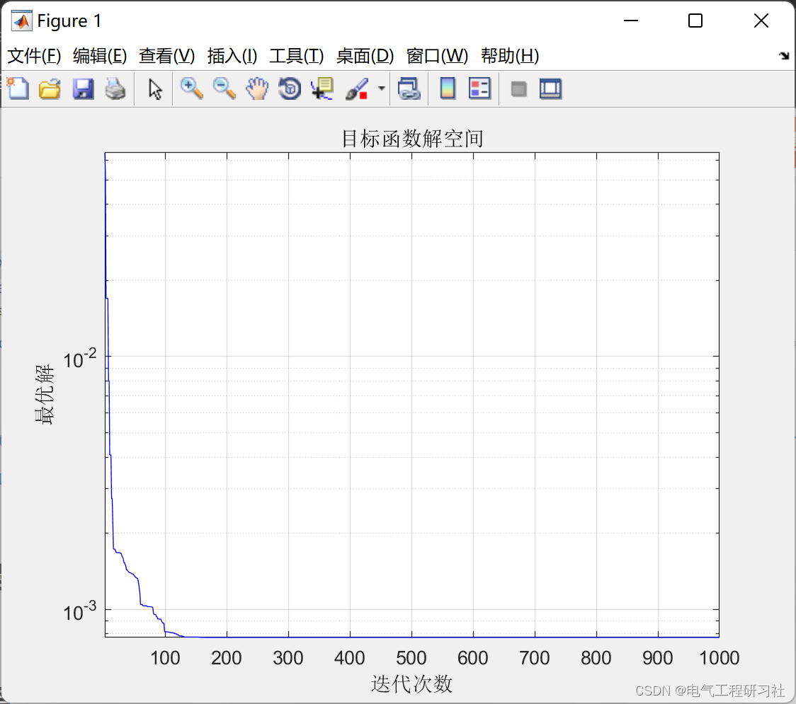
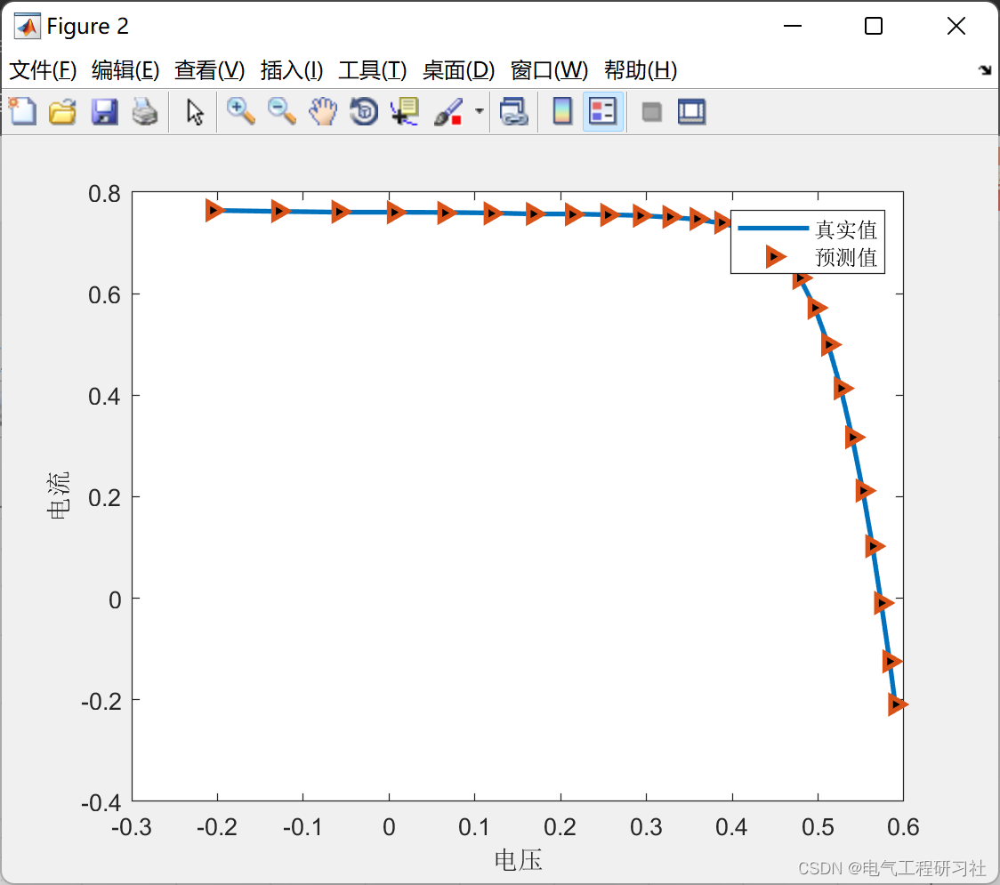
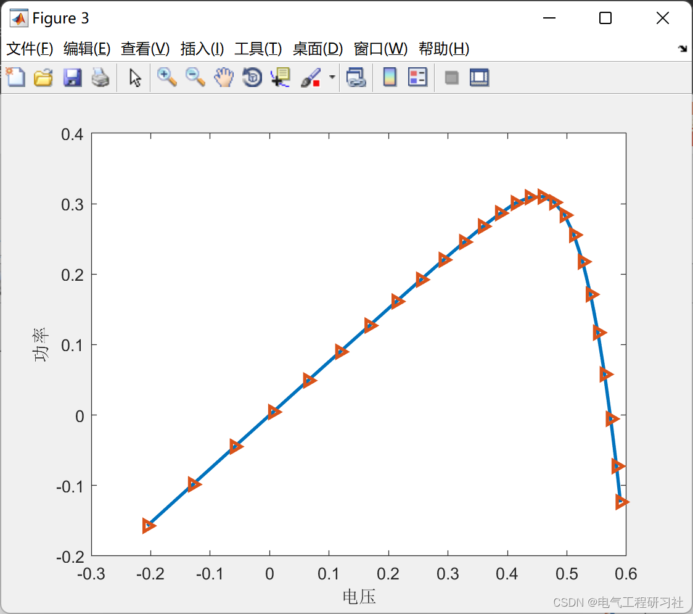
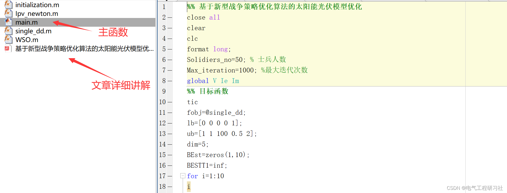

# Optimization of Photovoltaic Model Based on New Warfare Strategies Algorithm (Matlab Code Implementation)

1. Overview
Due to numerous factors related to climate change and energy crises, the use of renewable energy has increased recently. Solar power generation systems are widely used in large-scale photovoltaic (PV) power plants. Particularly, photovoltaic systems are often installed in exposed areas, which can deteriorate under adverse weather conditions such as heavy rainstorms and strong winds.
1.2 To address this issue, a more accurate data-driven model is needed to determine the fundamental characteristics of solar industry photovoltaic systems. A detailed analysis of solar model parameter extraction is beneficial for performance assessment of photovoltaic stations, efficiency calculations, and optimal energy management of photovoltaic systems.
3.
Generally speaking, the detailed modeling of a solar photovoltaic system involves two stages: the development of mathematical models and the identification of parameters. Among all models, the single-diode model (SDM) and the dual-diode model (DDM) are widely used in all practical scenarios. However, unspecified parameters primarily affect the actual performance of the photovoltaic model. If these models are subject to accidental aging of equipment, they may manifest as unstable and prone to errors. Therefore, accurately estimating the parameters of photovoltaic cells is a crucial simulation task. Additionally, the installation and optimization of the photovoltaic system should be more accurate. Nevertheless, the PV model is assumed to be a non-convex nonlinear system. This model's solution poses several issues and obstacles.Recently, researchers have made significant efforts to determine the methods for accurately estimating unknown parameters. Approximately three methods have been roughly identified. They are analytical methods, deterministic methods, and metaheuristic methods, which are explained as follows:
1.1 Analysis method The analysis method estimates parameters based on data provided by the supplier. For example, open-circuit voltage. Short circuit current, Manufacturer's maximum power point and I-V characteristics. 9,  10 In the analytical methods, All data points in the I-V characteristic curve are used to identify parameters that reduce the error between predicted and measured values. However, The analysis method uses widely used mathematical formulas. And with its simplicity. Speed and uniqueness are renowned. Furthermore, Some mathematical formulas are derived and simplified on the basis of assumptions. 11,  12. Therefore, By using these methods, The derived parameters are not accurate.
1.2 Deterministic Method The deterministic method is based on the strategy of "acquiring all actual measurement data for the entire system". Relatively large amounts of measurements are used to extract unknown parameters. 13-15 It is based on a target function, This function represents the difference between experimental data points and estimated data points. Since these algorithms are based on gradient information, Therefore, they may converge to a local optimum solution.
1.3 The primitive heuristic method is also similar to the deterministic method. Because they are also based on the "get all actual measurement data of the whole system" strategy. They are considered the global best optimization algorithms. Because they have several advantages. For example, robustness. Performance and reliability. Simplicity. Easy to implement, etc. Recently, people are paying more and more attention to metaheuristics. Because these phenomena are generally guided by bio-processes with ideological patterns, These processes have found the best solutions for real-world problems. The primitive heuristic algorithm is divided into different literary categories. As shown below:
1.3.1 Evolution-based algorithms
These algorithms originated from evolution theory. Some popular evolutionary algorithms are Genetic Algorithms (GA), Differential Evolution Algorithms (DEA), Evolution Strategies Algorithms (ESA), etc.
1.3.2 Group-based algorithms
1.3.3 Physical-based algorithms
Physical-based algorithms are influenced by natural physical laws. Some examples of this category include Gravitational Search Algorithm (GSA), Magnetic Optimization Algorithm, Sine-Cosine Algorithm (SCA), Artificial Electric Field Optimization, etc.
1.3.4 Human behavior-based algorithms
Recently, optimization algorithms inspired by human behavior have been proposed in the literature. Examples of these include Teaching Learning Based Optimization (TLBO), Political Optimizer, League Championship Algorithm, etc.
The most common method for precise modeling of photovoltaic cells and modules is through simulation circuits. Many photovoltaic researchers usually prefer SDM and DDM modeling. The SDM PV model has five parameters that must be precisely determined to simulate single diode cells and modules. The DDM PV model contains seven relevant parameters that must be precisely determined to simulate dual diode cells and modules. It is necessary to estimate the five or seven parameters of the PV cell/module to accurately simulate the I-V characteristics of the physical system. The absolute error between measured and predicted currents of the PV cell/module should be minimized.
Photovoltaic (PV) modules or solar cells are characterized electrically by circuit models with specific parameters. For the simulation and operation of photovoltaic systems, it is essential to use experimental data to precisely calculate the parameters of solar cells. In various working conditions, such as variable solar radiation and temperature, the system performance is analyzed using I-V characteristic analysis systems, requiring the extraction of unknown parameters for the solar photovoltaic system. However, the problem of solar photovoltaic modeling is inherently highly nonlinear. To address this issue, an effective algorithm is necessary. Therefore, in this study, we propose a novel metaheuristic optimization algorithm inspired by ancient war strategies. The War Strategy Optimization (WSO) algorithm is based on the strategic maneuvers of armies during wartime.Warfare strategy is modeled as an optimization process, where each soldier dynamically moves towards the global optimal value. Each soldier is assigned a unique weight, and their current position is dynamically updated based on the success rate of the previous iteration. The objective function used in previous studies on solar photovoltaic model parameter extraction was incorrect. However, in this work, we integrate the Newton-Raphson method with the WSO algorithm to improve the accuracy of the output solution. Experimental results show that this algorithm exhibits superior performance compared to existing algorithms.
Download link: War Strategy Optimization Algorithm: A New Effective Metaheuristic Algorithm for Global Optimization | IEEE Journals & Magazine | IEEE Xplore
3 The photovoltaic model optimization mathematical model based on the new war strategy optimization algorithm is presented in Section 5.
4 Run results editing
Editing
Editing
5 Matlab code and detailed explanation of the article only show part of the code, all codes can be found in:
Editing
%% Optimization of Solar Photovoltaic Model Based on New Warfare Strategies Algorithm\nclose all\nclear\nclc\nformat long;\nSolidiers_no=50; % Number of soldiers\nMax_iteration=1000; %Maximum number of iterations\nglobal V Ie Im\n%% Target function\ntic\nfobj=@single_dd;\nlb=[0 0 0 0 1];\nub=[1 1 100 0.5 2];\ndim=5;\nBEst=zeros(1,10);\nBESTT1=inf;\nfor i=1:10\ni\n\n[Best_score,Best_pos,WSO_cg_curve]=WSO(Solidiers_no,Max_iteration,lb,ub,dim,fobj);\nBEst(i)=Best_score;\nif Best_score<BESTT1\n    BESTT1 = Best_score;\n    BESTT2=Best_pos;\nend\n% BEst(i)=min(PSO_cg_curve);\nend\ntoc\nS=std(BEst)\nA=mean(BEst)  \nB=min(BEst)\nsingle_dd(BESTT2)\n%% Visualization\nfigure(1)\n\nsemilogy(WSO_cg_curve,'Color','b')\ntitle('Solution space of the objective function')\nxlabel('Iteration count');\nylabel('Optimal solution');\n\naxis tight\ngrid on\nbox on\n\nfigure(2)\nplot(V,Im,'LineWidth',2)\nhold on\nplot(V,Ie,'>','LineWidth',2,'MarkerFaceColor','black')\nxlabel('Voltage')\nylabel('Current')\nlegend('True value','Predicted value')\n\nfigure(3)\nplot(V, V.*Im,'LineWidth',2)\nhold on\nplot(V,V.*Ie,'>','LineWidth',2)\nxlabel('Voltage')\nylabel('Power')\n  
​  

## Images

<!-- PAYMENT_BLOCK -->

## Get this dataset

- Payment link (Stripe): [Buy now](https://buy.stripe.com/3cs8yP7sY87d0vu9AB)
- Payment QR code: 

<!-- /PAYMENT_BLOCK -->
